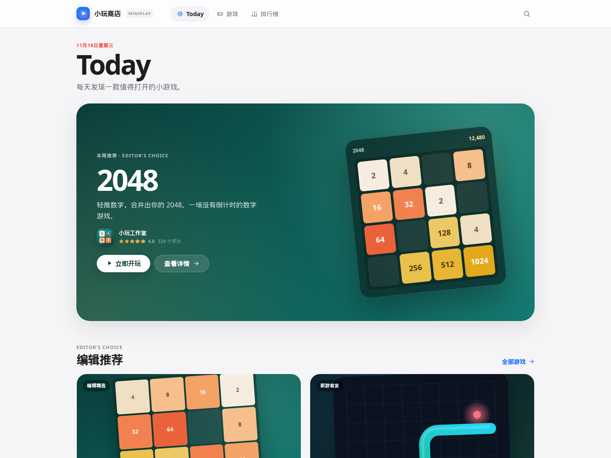
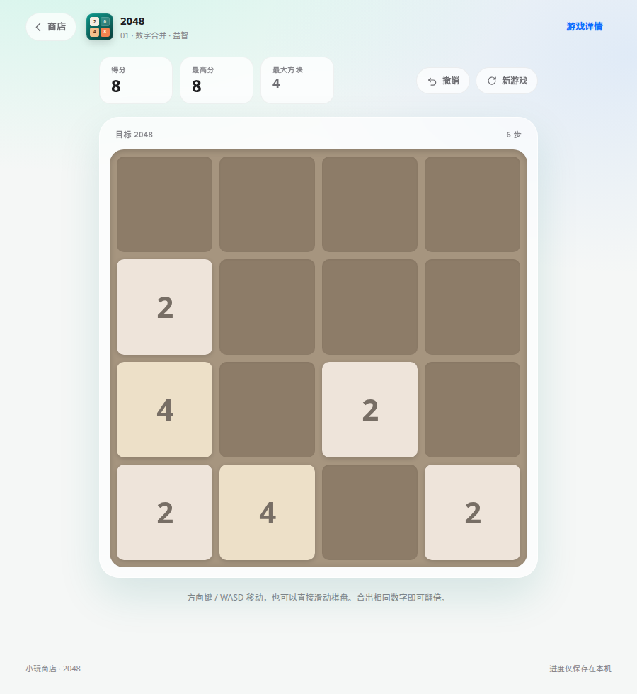
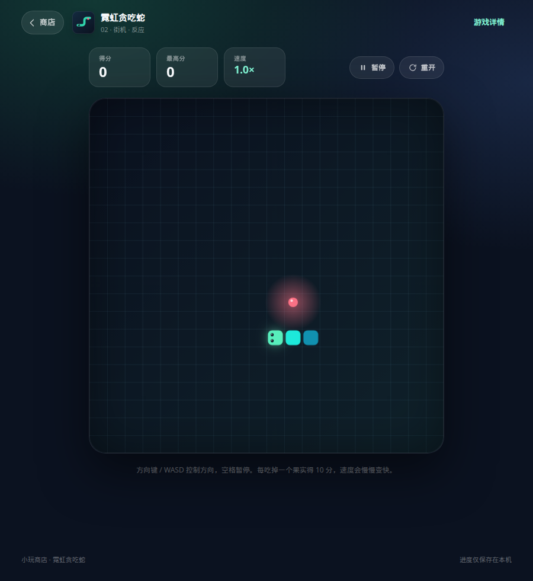

# 小玩商店 MiniPlay

一个 App Store 画风的小游戏平台。发现、收藏并直接在浏览器里开玩轻量小游戏，首发上架《2048》和《霓虹贪吃蛇》两款作品。

## 这是什么

小玩商店把一个「商店」该有的体验做完整了：Today 编辑推荐、分区浏览、排行榜、搜索、游戏详情、收藏与最近游玩。所有游戏都是原生前端实现，没有下载、安装或注册流程，打开就能玩。



## 首发游戏

### 2048

经典 4×4 数字合并。方向键、WASD、鼠标滑动或触屏均可操作；支持一步撤销、最高分本地保存，合出 2048 后可继续挑战。



### 霓虹贪吃蛇

20×20 网格的经典贪吃蛇，配霓虹视觉。吃得越多速度越快；支持键盘、屏幕方向键和滑动，空格暂停，最高分保存在本机。



## 功能

- **Today**：日期、主打推荐、编辑精选、本周新游、分区入口、排行榜预览与平台介绍
- **游戏**：全部分区筛选、游戏卡片、即将上架占位、收藏列表
- **分区**：益智、街机、休闲、反应四个分区，带各自配色和游戏数量
- **排行榜**：免费游戏榜 / 编辑推荐榜 / 新游榜三种榜单切换
- **搜索**：按游戏名、标签、分区、开发者搜索，热门搜索与空结果状态
- **游戏详情**：截图预览、评分分布、玩法说明、App Store 式信息栏、收藏
- **游戏运行页**：沉浸式全屏游玩、最高分、暂停 / 重开、键盘和触屏操作
- **本地数据**：收藏、最近游玩、最高分存于 `localStorage`，无账号、无后端
- **响应式**：桌面顶部导航 + 移动端底部 Tab Bar，适配窄屏与安全区

更多界面见 [`docs/screenshots`](docs/screenshots)。

## 技术栈

- React 19 + TypeScript
- Vite 7（构建与开发服务器）
- 手写 CSS 设计系统（自定义属性、渐变、毛玻璃、响应式）
- 哈希路由（无需服务端配置，静态托管即可）
- Vitest 纯函数单元测试
- 无运行时第三方 UI / 游戏 / 路由依赖

## 开始使用

```bash
npm install
npm run dev        # http://127.0.0.1:5173
```

生产构建与预览：

```bash
npm run build
npm run preview    # http://127.0.0.1:4173
```

## 校验

```bash
npm run typecheck  # TypeScript 严格模式
npm test           # 2048 / 贪吃蛇逻辑测试
npm run build      # 类型检查 + 生产构建
```

截图（需要先运行 `npm run preview`，依赖本机 Google Chrome）：

```bash
npm run screenshots
```

## 目录结构

```text
src/
├─ components/       # 商店外壳、评分、图标与程序化游戏插画
├─ context/          # 收藏 / 最近游玩 / 最高分（localStorage）
├─ data/catalog.ts   # 游戏与分区数据
├─ games/
│  ├─ game2048/      # 棋盘组件 + 纯逻辑 + 单元测试
│  └─ snake/         # Canvas 组件 + 纯逻辑 + 单元测试
├─ hooks/            # 哈希路由、滑动、滚动复位
├─ pages/            # Today / 游戏 / 分区 / 排行榜 / 搜索 / 详情 / 游玩
└─ styles/           # tokens / base / layout / components / pages / games / responsive
scripts/
└─ capture-screenshots.mjs
.github/workflows/ci.yml
```

路由全部使用哈希（例如 `#/game/2048`、`#/play/snake`），因此刷新任意页面都不需要服务器重写规则，`dist/` 可以直接部署到任何静态托管服务。

## 数据与边界

- 平台没有后端。收藏、最近游玩和最高分只写入当前浏览器的 `localStorage`。
- 评分、评分人数与榜单排名是界面演示数据，用于呈现商店的信息结构，不代表真实用户评价。
- 内置游戏资源全部由代码绘制（CSS / SVG / Canvas），没有引用外部图片、字体或音频。
- 游戏逻辑与 UI 均为本项目原创实现，测试覆盖移动、合并、碰撞、食物生成与速度曲线等核心规则。

## License

仅用于学习与演示。
